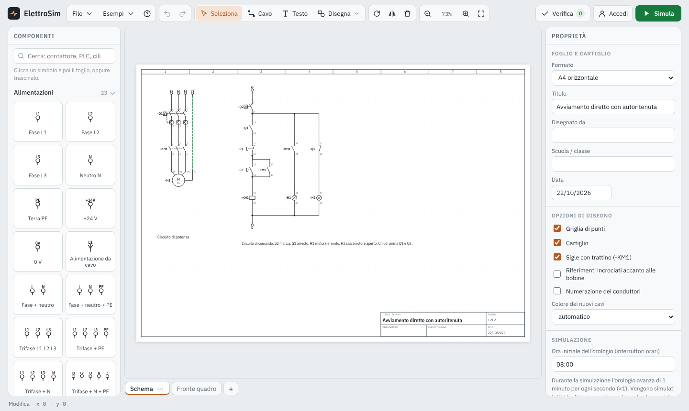
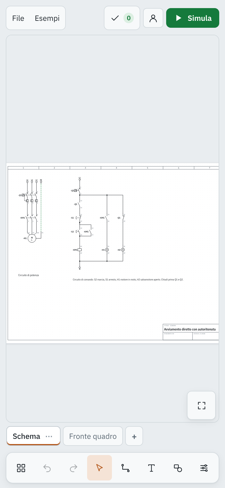

<p align="center"></p>

<h1 align="center">ElettroSim</h1>

<p align="center"><b>Disegna e simula schemi elettrici direttamente nel browser, anche da telefono.</b><br>
Impianti civili e industriali, PLC in ladder, GRAFCET, logica digitale e pneumatica.</p>

<p align="center"><a href="https://mattcoc.github.io/ElettroSim/"><b>▶ Apri ElettroSim</b></a></p>

<p align="center"> </p>

## Cosa puoi fare

- **Disegnare schemi** con oltre 250 simboli: alimentazioni, fusibili, magnetotermici, contattori, relè termici, motori, variatori, pulsanti, sensori, lampade, PLC, ladder, GRAFCET, pneumatica e vista del quadro.
- **Simulare il circuito**: premi *Simula* e aziona pulsanti, interruttori e sensori. I cavi in tensione si colorano, bobine e motori si attivano, temporizzatori e contatori funzionano.
- **Verificare lo schema**: il controllo segnala morsetti scollegati, sigle duplicate, cortocircuiti e altri errori.
- **Più fogli** collegati tra loro: elementi con la stessa sigla lavorano insieme anche su fogli diversi.
- **Esportare** in PDF, PNG o SVG, con cartiglio compilabile.
- **Salvare** nel browser, su file `.json` oppure **nel tuo account Google**, per ritrovare gli schemi su ogni dispositivo.
- **Lavorare in due (o più) sullo stesso schema** in tempo reale: *Lavora insieme* crea un link da mandare ai compagni.
- **Esempi pronti**: avviamento diretto, inversione di marcia, stella-triangolo, PLC, GRAFCET, porte logiche, variatore di frequenza.

## Come si usa

1. Scegli un simbolo dalla libreria **Componenti**: cliccalo e poi clicca sul foglio, oppure trascinalo.
2. Collega i morsetti: clicca su un morsetto e poi su un altro.
3. Dai le sigle nel pannello **Proprietà** (la bobina KM1 comanda tutti i contatti KM1).
4. Premi **Verifica**, poi **Simula**.

Il pulsante **?** (o il tasto F1) apre la guida con tutte le scorciatoie da tastiera. Sul telefono gli strumenti sono nella barra in basso; dal menu del browser puoi scegliere *Aggiungi a schermata Home* per usarla come un'app.

## Struttura del progetto

Tutta l'applicazione è nel file `index.html`, senza dipendenze da installare. Il sito è pubblicato con GitHub Pages dal branch `main`: ogni push aggiorna il sito in un paio di minuti.

| File | Contenuto |
| --- | --- |
| `index.html` | L'applicazione completa (interfaccia, simboli, simulatore) |
| `manifest.webmanifest`, `icon*.png`, `icon.svg` | Icona e installazione sul telefono |
| `docs/` | Immagini del README |

## Configurare gli account Google (Firebase)

Gli account sono già collegati al progetto Firebase `elettrosim-19adf`. Per usare un progetto diverso, o per rifare la configurazione da zero, e permettere agli utenti di accedere con Google e ritrovare schemi e blocchi su qualsiasi dispositivo:

1. Vai su <https://console.firebase.google.com>, crea un progetto (Google Analytics non serve).
2. **Authentication** › Inizia › metodo di accesso **Google** › Attiva › Salva.
3. **Authentication** › Impostazioni › **Domini autorizzati** › aggiungi il dominio del sito, ad esempio `mattcoc.github.io`.
4. **Firestore Database** › Crea database (modalità produzione, scegli una località europea, es. `eur3`).
5. Firestore › **Regole**: incolla queste regole e pubblica. Ogni utente legge e scrive solo i propri dati; gli schemi condivisi (`shared`) sono accessibili solo a chi conosce il link della sessione.
   ```
   rules_version = '2';
   service cloud.firestore {
     match /databases/{database}/documents {
       match /users/{uid}/{document=**} {
         allow read, write: if request.auth != null && request.auth.uid == uid;
       }
       match /shared/{room} {
         allow get, update: if request.auth != null;
         allow create: if request.auth != null && request.resource.data.owner == request.auth.uid;
         allow delete: if request.auth != null && resource.data.owner == request.auth.uid;
         match /people/{uid} {
           allow read: if request.auth != null;
           allow write: if request.auth != null && request.auth.uid == uid;
         }
       }
     }
   }
   ```
6. Impostazioni progetto (ingranaggio) › Le tue app › icona **Web** `</>` › registra l'app e copia l'oggetto `firebaseConfig`.
7. In `index.html` sostituisci `const FIREBASE_CONFIG = null;` con la configurazione copiata, ad esempio:
   ```js
   const FIREBASE_CONFIG = {
     apiKey: "...",
     authDomain: "tuo-progetto.firebaseapp.com",
     projectId: "tuo-progetto",
     storageBucket: "tuo-progetto.appspot.com",
     messagingSenderId: "...",
     appId: "..."
   };
   ```
   Questi valori non sono segreti: la protezione dei dati è data dalle regole del punto 5.

Dopo il push su `main` compare il pulsante **Accedi** in alto a destra. Gli schemi salvati con *File › Salva nel mio account* si aggiornano poi automaticamente a ogni modifica. Limite: circa 900 kB per schema (le immagini incorporate occupano molto spazio).
